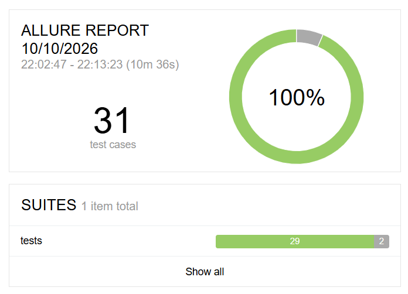
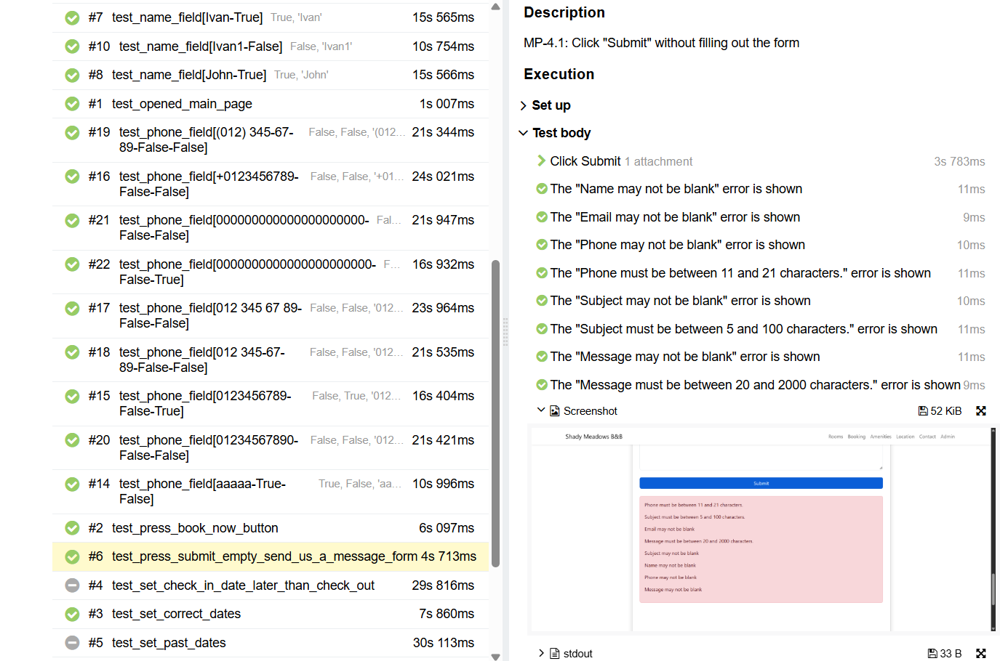

# python-selenium-booking-tests

[](https://github.com/ArseniyMyasnik/python-selenium-booking-tests/actions/workflows/tests.yml)

Automated UI tests for the demo booking website [Automation in Testing](https://automationintesting.online/) using **Python**, **Selenium WebDriver**, **pytest**, **Allure Report**, and the **Page Object Model** pattern.

This project was created as a QA Automation portfolio project. It demonstrates UI test automation, test design, pytest fixtures, Allure reporting, and a maintainable Page Object structure.

## Tech Stack

- **Python 3.x** - programming language
- **Selenium WebDriver 4.x** - browser automation
- **pytest 8.x** - test runner and test organization
- **Allure Report 2.x** - test execution reports
- **webdriver-manager 4.x** - browser driver management
- **GitHub Actions** - continuous integration
- **Page Object Model** - test architecture pattern

## What Is Covered

The project includes automated UI tests for the main page of the demo booking website:

- opening the main page;
- navigation to the rooms section;
- room availability checks;
- date validation scenarios;
- contact form validation;
- positive and negative input checks;
- expected failures for missing validation on the demo website.

## Project Structure

```text
python-selenium-booking-tests/
├── .github/
│   └── workflows/
│       └── tests.yml          # GitHub Actions workflow
├── docs/
│   └── images/
│       ├── allure-overview.png
│       └── allure-test-steps.png
├── pages/
│   ├── __init__.py
│   ├── base_page.py          # Common browser actions
│   ├── locators.py           # Page locators
│   └── main_page.py          # Main page object methods
├── tests/
│   ├── __init__.py
│   ├── conftest.py           # Browser setup and fixtures
│   └── test_main_page.py     # Automated UI tests
├── test-cases/
│   └── main-page-test-cases.md
├── __init__.py
├── constants.py
├── pytest.ini              # pytest configuration
├── requirements.in
├── requirements.txt
└── README.md
```

## Test Documentation

Manual test cases are stored in:

```text
test-cases/main-page-test-cases.md
```

They describe tested areas, test data, expected results, and negative scenarios for the main page functionality.

## Continuous Integration

The project uses **GitHub Actions** to validate test collection on every push and pull request.

For this portfolio project, CI checks test collection only.

The CI workflow installs project dependencies with `pip install -r requirements.txt` and runs:

```bash
pytest --collect-only
```

## Allure Report

The project uses **Allure Report** to make test execution results easier to analyze.

The report includes test statuses, execution time, detailed test steps, parameters, and screenshots attached during test execution.





## Quick Start

1. Clone the repository:

```bash
git clone https://github.com/ArseniyMyasnik/python-selenium-booking-tests.git
cd python-selenium-booking-tests
```

2. Create a virtual environment:

```bash
python -m venv venv
```

3. Activate the virtual environment.

Windows:

```bash
venv\Scripts\activate
```

Linux / macOS:

```bash
source venv/bin/activate
```

4. Install dependencies:

```bash
pip install -r requirements.txt
```

## Running Tests

Run all tests:

```bash
pytest
```

Run tests in headless mode:

```bash
pytest --headless
```

Run tests with Allure results:

```bash
pytest --alluredir=allure-results
```

Generate and open the Allure report:

```bash
allure serve allure-results
```

## Notes

Some tests are marked with `xfail` because the demo website does not display validation errors for certain invalid date scenarios.

These tests document expected behavior and highlight missing validation on the tested website.
